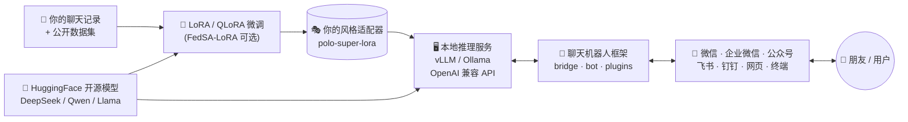

# Polo-Super Custom LLM Builder

> **一句话：用你自己的聊天记录，通过 LoRA 低秩微调，把开源大模型训练成"说话像你"的 AI 分身，并在本地部署后接入微信、企业微信、飞书、钉钉或网页聊天。**
>
> *Fine-tune an open-source LLM on your own chat history with LoRA (low-rank adaptation), serve it locally with vLLM/Ollama, and plug it into WeChat & other chat apps.*

## 🧐 这个项目做了什么？（给非技术读者）

想象一下：你有一个"数字分身"，朋友在微信里和它聊天，它的语气、口头禅、表达习惯都和你本人很像。这个项目就是做这件事的完整流水线：

| 步骤 | 通俗解释 | 用到的技术 |
| --- | --- | --- |
| 1. 准备素材 | 把你的聊天记录整理成"别人问 → 你答"的样本 | JSONL 数据集 |
| 2. 教模型学说话 | 不改动大模型本体，只额外训练一个很小的"风格插件"（几十 MB） | **LoRA / QLoRA 低秩微调**、FedSA-LoRA 联邦微调 |
| 3. 在自己电脑上运行 | 模型和数据都在本地，不上传云端，保护隐私 | **vLLM / Ollama** |
| 4. 接到聊天软件 | 让分身出现在微信、企业微信、公众号、飞书、钉钉或网页里 | 多渠道机器人框架 + 插件系统 |

**为什么用 LoRA（低秩/分秩）？** 大模型有几十亿参数，全部重新训练需要昂贵的服务器。LoRA 把"需要改变的部分"拆成两个很小的矩阵（A、B），只训练约 0.1%–1% 的参数，一张消费级显卡就能完成。

## 🏗️ 架构总览



更详细的消息时序图、训练流程图、FedSA-LoRA 联邦图和目录说明见 👉 **[docs/ARCHITECTURE.md](docs/ARCHITECTURE.md)**

## 🎬 演示 Demo

🎬 **Watch Super Polo in Action**

> **🎥 Click to watch the demo video:**

<p align="center">
  <a href="demo/chat_with_polo.mp4">
    
  </a>
</p>

*Demo: Super Polo AI Chatbot showcasing personalized conversation and web interface*

**What you'll see in the demo:**
- 🤖 **Personalized AI Character**: Super Polo interacting naturally like a real person
- 💬 **Natural Conversations**: Human-like responses without AI stereotypes
- 🌐 **Web Interface**: Clean, modern chat interface
- ⚡ **Real-time Responses**: Powered by DeepSeek model
- 🔧 **Multi-platform Ready**: Supports WeChat, web, and enterprise platforms

**Demo Features:**
- ✅ Personalized AI persona (Super Polo the tech enthusiast)
- ✅ Natural human-like conversation flow
- ✅ Web-based chat interface
- ✅ DeepSeek AI integration
- ✅ Plugin system for extended capabilities

## 🚀 快速开始

### 1. 启动本地模型（vLLM 示例）

```bash
pip install vllm
vllm serve Qwen/Qwen1.5-0.5B-Chat --port 8000
# 挂载自己训练的 LoRA：
# vllm serve <基座模型> --port 8000 --enable-lora --lora-modules polo-super=./polo-super-lora
```

> Mac / 无 NVIDIA 显卡可用 [Ollama](https://ollama.com)：`ollama run qwen2.5`，API 地址改为 `http://localhost:11434/v1`。

### 2. 配置并启动聊天机器人

```bash
pip install -r requirements.txt
cp config-template.json config.json
```

修改 `config.json` 中的关键字段：

```json
{
  "channel_type": "web",
  "bot_type": "chatGPT",
  "model": "Qwen/Qwen1.5-0.5B-Chat",
  "open_ai_api_base": "http://localhost:8000/v1",
  "open_ai_api_key": "EMPTY",
  "character_desc": "你是 Polo，说话轻松幽默，喜欢聊技术。"
}
```

```bash
python3 app.py
# 打开 http://localhost:9899/chat 开始聊天
```

`channel_type` 可选：`web`（网页）、`terminal`（命令行）、`wx`（个人微信，有封号风险）、`wechatmp`/`wechatmp_service`（公众号）、`wechatcom_app`（企业微信应用）、`feishu`、`dingtalk`。全部配置项见 [`config.py`](config.py)。

### 3. 训练你自己的风格模型

完整步骤（环境安装 → 加载 4bit 模型 → 准备数据 → LoRA 训练 → 保存/合并 → Ollama / vLLM 部署）见 👉 **[docs/FINETUNE_GUIDE.md](docs/FINETUNE_GUIDE.md)**

联邦低秩微调（多设备、数据不出本地）见 [`fedSA-LoRA/`](fedSA-LoRA) 与 [docs/ARCHITECTURE.md#4-fedsa-lora-联邦低秩微调](docs/ARCHITECTURE.md#4-fedsa-lora-联邦低秩微调)。

## 📚 文档导航

| 文档 | 内容 |
| --- | --- |
| [docs/ARCHITECTURE.md](docs/ARCHITECTURE.md) | 架构图、消息流程、训练流程、FedSA-LoRA、目录结构 |
| [docs/TECHNICAL_ANALYSIS.md](docs/TECHNICAL_ANALYSIS.md) | LoRA/QLoRA/FedSA-LoRA 原理、vLLM vs Ollama、应用层设计、**项目不足与优化路线图** |
| [docs/FINETUNE_GUIDE.md](docs/FINETUNE_GUIDE.md) | 手把手微调与部署教程 |

## ⚠️ 注意事项

- **隐私**：聊天记录包含他人信息，训练前请脱敏（手机号、姓名、地址等），并征得相关人同意。
- **基座一致**：部署时加载 LoRA 的基座模型和对话模板必须与训练时完全一致。
- **个人微信**：`wx` 渠道基于非官方协议，可能导致封号，建议优先使用网页、企业微信或公众号。

## 🙏 致谢

- 聊天机器人框架基于 [zhayujie/chatgpt-on-wechat](https://github.com/zhayujie/chatgpt-on-wechat)（MIT License）
- 联邦学习框架基于 [alibaba/FederatedScope](https://github.com/alibaba/FederatedScope)（Apache-2.0 License）
- FedSA-LoRA：*Selective Aggregation for Low-Rank Adaptation in Federated Learning*（ICLR 2025）
- 微调工具：[Unsloth](https://github.com/unslothai/unsloth)、[PEFT](https://github.com/huggingface/peft)、[TRL](https://github.com/huggingface/trl)；推理：[vLLM](https://github.com/vllm-project/vllm)、[Ollama](https://ollama.com)
