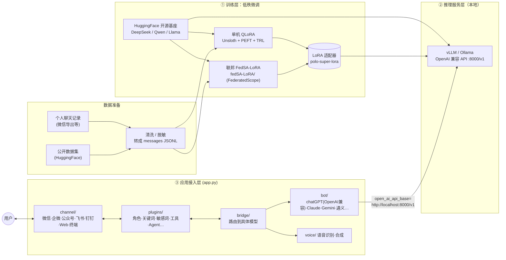
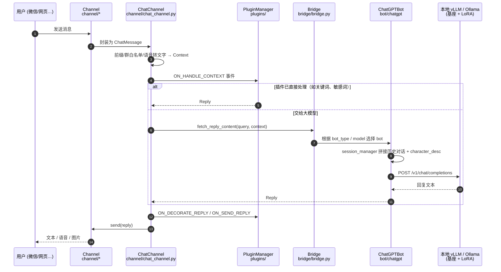
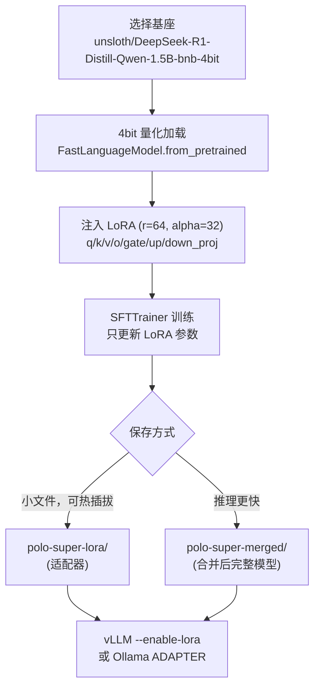
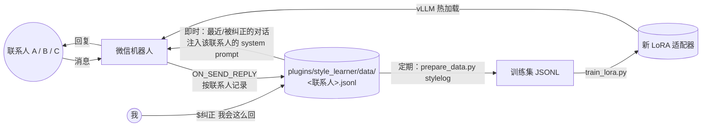
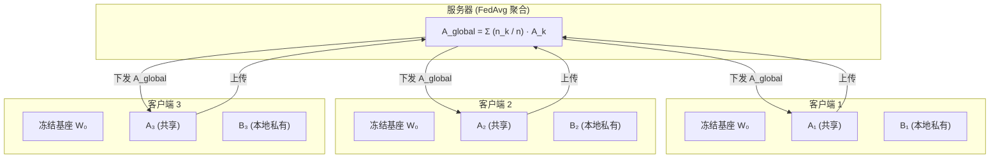

# 架构说明 (Architecture)

> 返回 [README](../README.md)｜技术原理见 [TECHNICAL_ANALYSIS.md](TECHNICAL_ANALYSIS.md)

本项目由三层组成：

| 层 | 作用 | 对应代码 |
| --- | --- | --- |
| ① 训练层 | 用 **LoRA / QLoRA**（低秩适配，即"分秩"微调）把开源大模型调成"像我一样说话"；支持 **FedSA-LoRA** 联邦式低秩微调，数据不出本地 | [`finetune/`](../finetune)、[`docs/FINETUNE_GUIDE.md`](FINETUNE_GUIDE.md)、[`fedSA-LoRA/`](../fedSA-LoRA) |
| ② 推理服务层 | 用 **vLLM / Ollama** 在本地把模型（基座 + LoRA 适配器）发布成 OpenAI 兼容接口 | 外部进程（见 `screencapture/`） |
| ③ 应用接入层 | 多渠道聊天机器人：微信、企业微信、公众号、飞书、钉钉、网页、终端，带插件系统；`StyleLearner` 插件按联系人记录对话并学习风格 | `app.py`、`channel/`、`bridge/`、`bot/`、`plugins/`、`voice/` |

## 1. 总体架构



## 2. 一条消息的处理流程



## 3. 训练流程（单机 QLoRA）



## 3.5 边聊边学：StyleLearner 闭环



- **即时学习（分钟级）**：每记录 `refresh_every` 轮对话或每次 `$纠正` 后，把该联系人最近的（优先被纠正的）对话作为风格示例写进系统提示，所以对老师、同学、家人会自动用不同的称呼和语气。
- **深度学习（定期）**：攒够数据后执行 `prepare_data.py stylelog`，再用 `train_lora.py` 重新训练，把风格写进 LoRA 权重。system prompt 里带有联系人名，模型能学到"对不同人怎么说"。
- **隐私**：记录只保存在本地，文件名是会话 ID 的哈希，`data/` 已加入 `.gitignore`。

## 4. FedSA-LoRA 联邦低秩微调

多个客户端（例如多台设备、多个人的聊天数据）各自在本地训练，**只上传 LoRA 的 A 矩阵**，服务器对 A 做平均后下发；**B 矩阵始终留在本地**作为个性化部分。



关键配置（[`fedSA-LoRA/federatedscope/llm/yamls/fedsa-lora.yaml`](../fedSA-LoRA/federatedscope/llm/yamls/fedsa-lora.yaml)）：

```yaml
federate:
  freeze_A: False          # True 时即 FFA-LoRA（冻结 A，只训练 B）
  client_num: 3
personalization:
  local_param: ['lora_B']  # B 不参与聚合 → FedSA-LoRA 的核心
llm:
  adapter:
    args: [{ adapter_package: peft, adapter_method: lora, r: 8, lora_alpha: 16 }]
```

实现位置：

- `federatedscope/core/trainers/trainer.py` → `_param_filter()`：按 `personalization.local_param` 过滤掉不上传的参数。
- `federatedscope/llm/model/model_builder.py` / `glue/model/model_builder.py`：`freeze_A` 为真时冻结 `lora_A`（FFA-LoRA 对照实验）。
- `fedSA-LoRA/exp/`：RoBERTa-large 在 GLUE-MNLI 上的 FedAvg 基线实验记录。

## 5. 目录结构

```text
.
├── app.py                  # 入口：读取 config.json → 创建 channel → 加载插件 → 启动
├── config.py               # 全部可用配置项及默认值
├── config-template.json    # 配置模板，复制为 config.json 使用
├── channel/                # ③ 接入渠道：wechat(itchat/wechaty/wcf)、wechatmp、wechatcom、wework、feishu、dingtalk、web、terminal
├── bridge/                 # 消息上下文 Context / Reply，以及按配置路由到具体 bot
├── bot/                    # 各家大模型适配；本地 vLLM/Ollama 走 chatgpt（OpenAI 兼容）
├── plugins/                # 插件：style_learner(风格学习)、role、keyword、banwords、tool、agent、godcmd…
├── voice/ translate/       # 语音识别/合成、翻译
├── lib/itchat/             # 个人微信协议库
├── finetune/               # ① 数据处理 prepare_data.py / 训练 train_lora.py / 评测 evaluate.py
├── fedSA-LoRA/             # ① 联邦低秩微调（基于 FederatedScope）
├── docs/                   # 文档：架构、技术分析、微调指南、训练报告(results/)
├── demo/ screencapture/    # 演示视频与 vLLM 部署截图
└── docker/ Dockerfile      # 容器化部署
```
