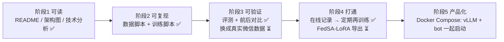

# 技术分析 (Technical Analysis)

> 返回 [README](../README.md)｜架构图见 [ARCHITECTURE.md](ARCHITECTURE.md)｜操作步骤见 [FINETUNE_GUIDE.md](FINETUNE_GUIDE.md)｜实验结果见 [TRAINING_REPORT.md](TRAINING_REPORT.md)

## 0. 一句话结论

这个仓库确实是 **"用低秩分解（LoRA，俗称分秩/低秩适配）技术低成本定制大模型，再接入微信等社交平台"** 的项目：

- **优化大模型** → LoRA / QLoRA 单机微调 + FedSA-LoRA 联邦低秩微调；
- **接入社交插件** → 基于 [chatgpt-on-wechat](https://github.com/zhayujie/chatgpt-on-wechat) 的多渠道机器人框架（微信、企业微信、公众号、飞书、钉钉、Web）；
- **本地部署** → vLLM / Ollama 提供 OpenAI 兼容接口，机器人通过 `open_ai_api_base` 指向本地模型。

---

## 1. LoRA：为什么"分秩"能省钱

大模型中每个线性层权重 $W_0 \in \mathbb{R}^{d \times k}$ 动辄几千 × 几千。全量微调要更新全部参数，显存和存储都扛不住。

LoRA 的假设：**微调带来的权重变化 $\Delta W$ 是低秩的**，所以可以分解成两个小矩阵：

$$
W = W_0 + \Delta W = W_0 + \frac{\alpha}{r} B A,\quad B \in \mathbb{R}^{d \times r},\ A \in \mathbb{R}^{r \times k},\ r \ll \min(d,k)
$$

- $W_0$ 冻结不动，只训练 $A$、$B$；
- $A$ 随机高斯初始化，$B$ 初始化为 0，保证训练开始时 $\Delta W = 0$；
- 以 $d=k=4096,\ r=8$ 为例：全量 16.8M 参数 → LoRA 仅 65K，**约 0.4%**。

| 超参 | 含义 | 本项目取值 |
| --- | --- | --- |
| `r` | 秩，越大表达力越强、显存越多 | 单机 QLoRA 64；FedSA-LoRA 8 |
| `lora_alpha` | 缩放系数，实际缩放 $\alpha / r$ | 32 / 16 |
| `target_modules` | 注入 LoRA 的层 | `q/k/v/o_proj` + `gate/up/down_proj`（注意力 + MLP 全覆盖） |
| `lora_dropout` | 正则 | 0（Unsloth 推荐，速度最快）/ 0.05 |

**带来的好处**：消费级显卡即可训练；适配器只有几十 MB，可以像"人格插件"一样热插拔；同一个基座可以挂多个人的 LoRA。

## 2. QLoRA：再省一半显存

QLoRA = **4bit NF4 量化的冻结基座 + 16bit 的 LoRA 适配器**：

- 基座以 4bit 加载（`load_in_4bit=True`，bitsandbytes），8B 模型约 5–6GB 显存；
- 反向传播时把基座权重临时反量化计算梯度，但只更新 LoRA；
- 配合 `use_gradient_checkpointing="unsloth"`、`adamw_8bit`、`packing=True` 进一步降显存、提速。

Unsloth 在此之上做了手写 Triton kernel，官方宣称训练速度约 2×、显存约 -60%。

## 3. FedSA-LoRA：联邦场景下的"选择性聚合"

来源论文：*Selective Aggregation for Low-Rank Adaptation in Federated Learning*（ICLR 2025），代码基于阿里 [FederatedScope](https://github.com/alibaba/FederatedScope)。

**核心发现**：在 LoRA 中，

- **A 矩阵倾向于学习"通用知识"**（不同客户端的 A 很相似）；
- **B 矩阵倾向于学习"客户端特有知识"**（不同客户端的 B 差异大）。

所以：**只聚合 A，B 留在本地**。

| 方法 | 上传 / 聚合 | 本地私有 | 本仓库配置 |
| --- | --- | --- | --- |
| FedAvg + LoRA | A、B 全部 | 无 | `local_param: []` |
| FFA-LoRA | 只训练并聚合 B，A 冻结 | — | `freeze_A: True` |
| **FedSA-LoRA** | **A** | **B**（+ 分类头） | `local_param: ['lora_B']` |

**与本项目目标的契合点**：

1. **隐私**：聊天记录不出设备，只上传 A 矩阵；
2. **个性化**：B 保留个人说话风格，A 共享通用语言能力——正好对应"像我说话"的需求；
3. **通信量**：每轮只传 A，比 FedAvg-LoRA 少一半。

> 注意：联邦平均理论上 $\overline{B A} \neq \bar{B}\,\bar{A}$，FedAvg 直接平均 A、B 存在聚合误差；FedSA-LoRA 只共享 A，B 本地保留，规避了这一问题。

## 4. 推理部署：vLLM vs Ollama

| | vLLM | Ollama |
| --- | --- | --- |
| 定位 | 高吞吐服务端推理 | 个人桌面一键运行 |
| 核心技术 | PagedAttention、连续批处理 | llama.cpp、GGUF 量化 |
| LoRA 支持 | `--enable-lora --lora-modules name=path`，多 LoRA 同时服务 | `Modelfile` 中 `ADAPTER`，需转 GGUF |
| 接口 | OpenAI 兼容 `/v1/chat/completions` | OpenAI 兼容 `/v1` + 原生 `/api` |
| 适合 | 多人/群聊并发 | 单人本地体验、Mac |

两者都提供 OpenAI 兼容接口，所以应用层无需改代码，只需配置：

```json
{ "bot_type": "chatGPT", "model": "Qwen/Qwen1.5-0.5B-Chat",
  "open_ai_api_base": "http://localhost:8000/v1", "open_ai_api_key": "EMPTY" }
```

## 5. 应用接入层设计

- **工厂 + 策略模式**：`channel_factory.create_channel()` 按 `channel_type` 创建渠道；`bot_factory.create_bot()` 按 `bot_type` 创建模型适配器。新增平台/模型只需加一个类。
- **桥接层** `bridge/`：统一 `Context`（输入）与 `Reply`（输出）结构，把渠道和模型解耦。
- **事件驱动插件**：`ON_RECEIVE_MESSAGE → ON_HANDLE_CONTEXT → ON_DECORATE_REPLY → ON_SEND_REPLY`，插件按优先级拦截/改写（角色扮演、敏感词、关键词、工具调用、AgentMesh 多智能体等）。
- **会话管理** `bot/session_manager.py`：按用户/群维护上下文，`character_desc` 作为 system prompt，`conversation_max_tokens` 控制截断，`expires_in_seconds` 过期清理。
- **人设两条路线**：
  - Prompt 人设（`character_desc` / `role` 插件）—— 零成本但"像不像"有上限；
  - LoRA 人设（本项目重点）—— 把说话风格"写进权重"，更自然。

---

## 6. 现状评估：这个 repo 还缺什么

| # | 问题 | 影响 | 建议 |
| --- | --- | --- | --- |
| 1 | **README 偏"教程拼贴"**，没有一句话说清做了什么、没有架构图 | 普通人看不懂 | ✅ 本次已重写 README + 架构图 + 本文 |
| 2 | **缺少端到端可运行脚本**：README 里的微调代码是片段，仓库中没有 `polo-super-finetune.py` | 无法复现 | ✅ 已新增 [`finetune/train_lora.py`](../finetune/train_lora.py)（CUDA / Apple MPS / CPU 通用） |
| 3 | **缺少数据处理工具**：没有"微信聊天记录 → JSONL"的转换与脱敏脚本，而这是"模仿我说话"的关键一步 | 最核心环节空缺 | ✅ 已新增 [`finetune/prepare_data.py`](../finetune/prepare_data.py)：微信导出 CSV / 在线记录 → JSONL，多轮合并、按联系人切分、手机号/身份证/卡号/邮箱/URL 脱敏、过滤图片/表情/撤回 |
| 4 | **FedSA-LoRA 与主应用未打通**：联邦训练产出的 `.ckpt` 如何转成 PEFT 适配器给 vLLM 加载没有说明 | 两部分像两个独立项目 | 补一个 `ckpt → adapter_model.safetensors` 导出脚本和使用说明 |
| 5 | `fedSA-LoRA/` 整个 FederatedScope 被复制进来（含 CV/GNN/攻击等无关模块）| 仓库臃肿、难读 | 改为 git submodule 或 `pip install` 依赖，只保留 `llm/`、`glue/` 和配置 |
| 6 | **没有效果评估**：微调前后"像不像我"没有量化 | 无法证明价值 | ✅ 已新增 [`finetune/evaluate.py`](../finetune/evaluate.py) 与 [训练报告](TRAINING_REPORT.md)：留出集 loss/困惑度、回复长度、distinct-n、字级 F1、前后对比样例；后续可加人工盲测 |
| 7 | **Modelfile 示例与基座不一致**：用 DeepSeek-Qwen 训练，却 `FROM llama3.1:8b` + Llama 模板 | 照抄会出错 | 模板必须与训练基座一致（已在 README 中提示） |
| 8 | **配置示例缺本地模型**：`config-template.json` 默认指向 OpenAI | 新手不知道如何连 vLLM | ✅ README 快速开始已给出本地配置示例 |
| 9 | 上游致谢与许可不清晰 | 合规风险 | ✅ README 已补充致谢（chatgpt-on-wechat: MIT；FederatedScope: Apache-2.0） |
| 10 | 无测试 / CI | 改动容易出错 | 加最小冒烟测试（配置加载、channel/bot 工厂、mock LLM 回复） |
| 11 | 个人微信（itchat）有封号风险 | 用户踩坑 | README 提示优先使用 Web / 企业微信 / 公众号渠道 |
| 12 | 实验产物（`exp/*.raw.gz`）、截图、视频直接入库 | 仓库体积大 | 用 Git LFS 或 Release 附件 |
| 13 | **机器人不会随聊天学习**：回复不记录，也无法针对不同联系人调整风格 | "越聊越像"无从谈起 | ✅ 已新增 [`plugins/style_learner`](../plugins/style_learner)：按联系人记录对话、`$纠正` 人工纠错、把该联系人的历史风格示例注入 system prompt；记录可导出再训练 LoRA |

## 7. 优化路线图（建议）



在模型层面还可以尝试：

- **DoRA / rsLoRA / PiSSA**：LoRA 变体，同样秩下效果通常更好；
- **DPO / ORPO**：用"我会这么回 vs 我不会这么回"的偏好数据进一步对齐风格；
- **RAG + LoRA**：LoRA 学"怎么说"，RAG 提供"说什么"（个人知识、近期事件），避免模型编造个人经历；
- **多 LoRA 路由**：vLLM 同时挂载多个人格适配器，按群/用户切换。
